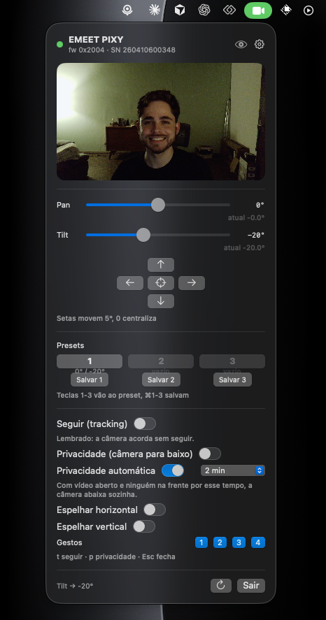

# pixy-control · PixyBar

**Controle local da webcam EMEET PIXY no macOS, sem o EMEET STUDIO.**
App de barra de menu leve (Swift, 1 binário, abre em menos de um segundo) + protocolo HID documentado + CLI em Python.

<p align="center"></p>

> *English:* PixyBar is a tiny macOS menu bar app that controls the EMEET PIXY gimbal webcam (pan/tilt, presets, AI tracking, privacy mode, gestures, flip) over its vendor HID interface, reverse engineered from EMEET STUDIO 2.0.4. The protocol is documented in [PROTOCOLO.md](PROTOCOLO.md) (Portuguese) and the command table is in [`pixy/commands.json`](pixy/commands.json). Not affiliated with EMEET.

---

## Por que

O EMEET STUDIO tem 250 MB, carrega Qt3D, OBS, ffmpeg e uma extensão de câmera virtual só para você mexer no pan da câmera. Todo o controle da PIXY passa por uma interface HID simples. O PixyBar fala direto com ela.

## Baixar e instalar

1. Baixe o `.dmg` ou o `.zip` da [última release](../../releases/latest).
2. Arraste `PixyBar.app` para `Aplicativos` (ou `~/Applications`).
3. **Primeira abertura:** o app é assinado localmente e não é notarizado pela Apple, então o macOS vai barrar. Faça uma destas:
   - Clique com o botão direito em `PixyBar.app` › **Abrir** › **Abrir**; ou
   - Ajustes › Privacidade e Segurança › role até o aviso do PixyBar › **Abrir Mesmo Assim**; ou
   - no Terminal: `xattr -dr com.apple.quarantine /Applications/PixyBar.app`
4. Feche o EMEET STUDIO (ele abre a HID em modo exclusivo e bloqueia qualquer outro app).
5. Clique no ícone de câmera na barra de menu. Na primeira vez o macOS pede permissão de câmera para o vídeo no painel.

Requisitos: macOS 13 ou mais novo, EMEET PIXY por USB.

## O que o app faz

| | |
|---|---|
| **Pan e tilt** | sliders (±150° / ±90°) com a posição real; setas movem 2°, 5° ou 10°; `0` centraliza |
| **Presets** | 3 posições salvas no Mac; teclas `1`–`3` vão, `⌘1`–`⌘3` salvam |
| **Seguir (tracking)** | liga/desliga (`t`); a escolha fica salva e é reaplicada quando a câmera acorda |
| **Privacidade** | manual (`p`): a câmera aponta para baixo; automática: na hora, 10 s, 30 s, 2 min ou 5 min sem atividade, gravada no firmware |
| **Imagem** | espelhamento horizontal e vertical; gestos 1–4 |
| **Vídeo** | preview da câmera dentro do painel (botão de olho esconde) |
| **Configurações** | abrir junto com o Mac, passo das setas, vídeo ao abrir, reaplicar o seguir |
| **Teclado** | `Esc` fecha, `⌘R` atualiza, `⌘Q` sai |

O app **não consulta a câmera em segundo plano**: qualquer comando HID reinicia o contador da privacidade automática do firmware. Para saber que a câmera acordou, ele observa quando outro app abre o vídeo.

## Compilar do código

Não precisa de Xcode, só das Command Line Tools (`xcode-select --install`).

```bash
git clone https://github.com/paulovictordsz/pixy-control.git
cd pixy-control/PixyBar
./build.sh            # gera build/PixyBar.app
open build/PixyBar.app
```

`../tools/make-release.sh` gera o `.zip` e o `.dmg` em `dist/`.

Observação: o toolchain das Command Line Tools não traz o plugin de macros do SwiftUI, então `@State`/`@Observable` não compilam; o estado vive em `ObservableObject`s.

## CLI em Python (testes e automação)

```bash
brew install hidapi
python3 pixy_cli.py devices              # acha a câmera
python3 pixy_cli.py info                 # versão, SN, estado
python3 pixy_cli.py pos pan 15           # pan = 15°
python3 pixy_cli.py pos tilt -10
python3 pixy_cli.py gesture 3 off
python3 pixy_cli.py flip h on
python3 pixy_cli.py scan                 # tenta todos os GETs
python3 pixy_cli.py -v get GET_VER       # mostra os bytes
python3 pixy_cli.py set SET_REVERSE_STA 01 00   # qualquer comando, bytes crus
```

Sem dependências pip; o wrapper usa a `libhidapi` do Homebrew por ctypes. Abre a HID em modo compartilhado, então convive com o PixyBar aberto.

## O protocolo em 30 segundos

- PIXY = VID `0x328F`, PID `0x00C0`. Interface HID 4, usage page `0x83`, report ID `0x09`, 32 bytes.
- Report: `[09][grupo][sub][id][frag][len lo][len hi][len chunk][payload ≤ 24]`. Resposta ecoa os 4 bytes do cabeçalho.
- Motores e gimbal usam device type 3 nos 3 bits altos do byte 1 (`0x63`).
- 161 comandos extraídos dos inicializadores estáticos do EMEET STUDIO (`EMHidCmdHelper::CMD_*`), tabela em [`pixy/commands.json`](pixy/commands.json), tamanhos de payload em [`analysis/cmd_lens.txt`](analysis/cmd_lens.txt).
- Tudo que foi validado na câmera real, com layouts de payload, limites e comportamento dos modos, está em [PROTOCOLO.md](PROTOCOLO.md).

## Outros modelos EMEET

Só a PIXY (firmware `0x2004`) foi testada. O EMEET STUDIO usa o mesmo protocolo "V2" para C960, C60E, Nova, S600, Piko e outros; muitos comandos da tabela (luz LED, Wi-Fi, SD, HDR, mic) são dessas linhas e a PIXY nem responde. Se você tem outro modelo, `python3 pixy_cli.py scan` mostra o que ele responde. Relatos são bem-vindos nas issues.

## Segurança

- O CLI bloqueia por padrão upgrade de firmware, factory reset, formatação de SD e senha.
- Comandos desconhecidos são ignorados pelo firmware. Nenhum teste derrubou a câmera.
- Mesmo assim: use por sua conta e risco. Este projeto não tem relação com a EMEET.

## Estrutura

```
PixyBar/            app Swift (Package.swift, Sources/PixyBar, Resources, build.sh)
pixy/               protocolo em Python (hidapi.py, protocol.py, api.py, commands.json)
pixy_cli.py         linha de comando
PROTOCOLO.md        documentação do protocolo
analysis/           scripts e saídas da engenharia reversa
tools/              makeicons.swift, camstream.swift, make-release.sh
```

## Licença

MIT. Veja [LICENSE](LICENSE).
